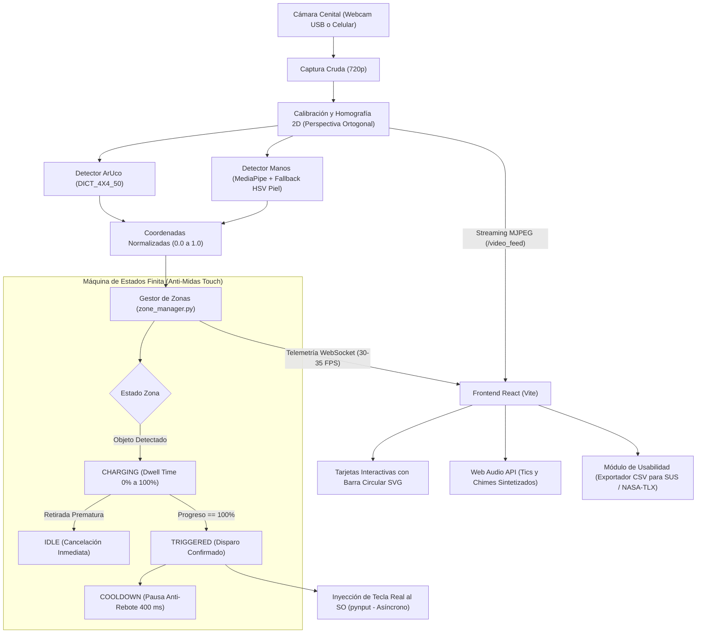

# PROYECTO TUI-A: Interfaz de Escritorio Tangible Accesible
### Superficie Aumentada de Bajo Costo Mediante Visión Artificial para Usuarios con Reducción Motora Distal

> **Curso:** Interacción Hombre-Máquina (IHM / HCI)  
> **Integrantes:**  
> - Bryan Mango Ticllahuanaco  
> - Anthony Luque Guzmán  
> **Repositorio Oficial:** [github.com/1234alexis12/hombreMaquina](https://github.com/1234alexis12/hombreMaquina)

---

## 📌 1. Resumen Ejecutivo y Planteamiento del Problema

Los teclados y ratones estándar se diseñaron asumiendo una motricidad fina y coordinación muscular intactas: una tecla promedio mide apenas **$1.5\text{ cm}^2$** y requiere aislar dedos individuales, aplicar fuerza calibrada y mantener puntería milimétrica. Para usuarios con **parálisis, distrofia muscular, artritis severa, secuelas de ACV, temblores esenciales (Parkinson) o amputaciones**, este diseño genera una barrera física insalvable:
- Pulsación continua e involuntaria de teclas vecinas.
- Imposibilidad de ejecutar combinaciones (Ctrl+Z, Alt+Tab).
- Fatiga muscular temprana y frustración.
- El hardware comercial especializado existente es rígido y presenta costos prohibitivos (\$300 a \$1,500 USD).

**TUI-A invierte este paradigma:** en lugar de forzar a la persona a adaptarse a la rigidez del teclado, el entorno se adapta a las capacidades residuales del usuario. Mediante una cámara cenital económica (webcam o smartphone) y visión artificial, una mesa ordinaria se transforma en una **superficie aumentada interactiva**, donde las teclas se activan apoyando la palma/puño completo o deslizando un bloque físico con marcador fiducial ArUco.

---

## 🎯 2. Los 4 Problemas Centrales que Soluciona

1. **La barrera de la motricidad fina (Tamaño de teclas):**  
   Reemplaza teclas diminutas de $1.5\text{ cm}^2$ por macrozonas de activación sobre la mesa ($\ge 10\times 10\text{ cm}$), permitiendo al usuario operar con la motricidad gruesa del antebrazo y hombro.
2. **El "Efecto Midas Touch" (Activaciones involuntarias por visión):**  
   En interfaces continuas por cámara, cualquier roce accidental dispararía órdenes no deseadas. TUI-A implementa **Dwell Time** (temporizador de permanencia de ~800 ms) cancelable de inmediato si el usuario retira la mano antes de tiempo.
3. **La fatiga muscular y falta de tacto (Síndrome del Brazo de Gorila):**  
   Interactuar en el aire o sobre cristal plano fatiga las extremidades y carece de relieve. TUI-A aprovecha la mesa como punto de descanso físico y provee **retroalimentación háptica pasiva natural** a través de bloques físicos con peso, resistencia y fricción.
4. **El costo prohibitivo y la rigidez de la tecnología asistiva:**  
   Reduce el costo a prácticamente cero utilizando cámaras web comunes o celulares, marcadores impresos en papel y software libre reconfigurable en segundos.

---

## 🧠 3. Fundamentos de Interacción Humano-Computadora (IHM / HCI)

* **Ley de Fitts ($ID = \log_2(2D/W)$):**  
  Al multiplicar el ancho del objetivo ($W$), se reduce drásticamente el Índice de Dificultad ($ID$), optimizando los tiempos de movimiento y minimizando la tasa de fallos en usuarios con problemas de control motor.
* **Interfaces Tangibles (TUI - Ishii & Ullmer, 1997):**  
  Integración directa entre bits y átomos. El bloque físico actúa como representación física y control digital simultáneo (*affordance* inmediato).
* **Control del Efecto Midas Touch (Jacob, 1990):**  
  Filtrado temporal riguroso que separa movimientos de reposo o transición de acciones genuinamente intencionales.
* **Retroalimentación Multimodal (Norman, 2013):**  
  - *Feedforward:* Zonas delimitadas visualmente en la mesa y en la interfaz gráfica.
  - *Continuous Feedback:* Anillo circular dinámico y tics sonoros continuos a frecuencias crecientes (350 Hz a 650 Hz).
  - *Success Feedback:* Pulso visual verde y acorde armónico (*chime* en $C_5 - G_5$) al confirmar la orden en el sistema operativo.

---

## 🏗️ 4. Arquitectura y Flujo de Datos End-to-End



---

## ⚙️ 5. Pipeline Técnico de Visión y Lógica Central

### A. Calibración de Perspectiva y Homografía (`camera.py`, `calibration.py`)
- Se seleccionan 4 puntos de la mesa: Superior-Izquierda, Superior-Derecha, Inferior-Derecha, Inferior-Izquierda.
- Se mapean mediante `cv2.getPerspectiveTransform` a un rectángulo canónico de $800 \times 600\text{ px}$.
- `cv2.warpPerspective` normaliza la imagen en cada cuadro, asegurando que las distancias físicas sobre la mesa sean proporcionales sin importar la inclinación de la cámara.

### B. Detección Dual (Híbrida)
- **Bloque Tangible ArUco (`aruco_detector.py`):**  
  Diccionario `DICT_4X4_50`. Detecta las 4 esquinas de los marcadores adheridos a cubos físicos y extrae el centroide promedio:  
  $$C_{\text{bloque}} = \left(\frac{1}{4}\sum x_i, \; \frac{1}{4}\sum y_i\right)$$
- **Mano / Puño (`hand_detector.py`):**  
  - *Ruta Principal:* MediaPipe Hands extrayendo los landmarks de la palma: Muñeca (0), Nudillo Índice (5), Nudillo Medio (9) y Nudillo Meñique (17). Al usar la base de la palma, se vuelve inmune al temblor involuntario de los dedos.
  - *Ruta Fallback:* Segmentación de color de piel en espacio HSV y cálculo de contornos mayores a $2500\text{ px}^2$ mediante momentos espaciales ($M_{10}/M_{00}$, $M_{01}/M_{00}$), permitiendo reconocer puños cerrados o ángulos difíciles.

### C. Máquina de Estados y Prevención del Midas Touch (`zone_manager.py`)
- **`IDLE`:** Zona vacía, progreso 0%.
- **`CHARGING`:** Objeto detectado en la región. El progreso avanza linealmente respecto al tiempo transcurrido / tiempo configurado. Si el usuario retira la mano antes del 100%, se limpia el temporizador a 0 de forma instantánea.
- **`TRIGGERED`:** Progreso al 100%. Se ejecuta el callback de pulsación de teclado físico en el SO una sola vez.
- **`COOLDOWN`:** Pausa de 400 ms posterior al disparo para evitar repeticiones múltiples no deseadas.

### D. Emulación de Teclado Físico (`keyboard_controller.py`)
- Emplea `pynput.keyboard.Controller` ejecutado en hilos asíncronos (`threading.Thread`) independientes para no bloquear el bucle de procesamiento de video ni generar pérdidas de FPS.

### E. Feedback Multimodal en el Frontend (`useSoundEffects.js`, `ZoneCard.jsx`)
- **Visual:** Renderizado de arco SVG reactivo con `strokeDashoffset` proporcional al avance del Dwell Time y animaciones de destello verde en activación.
- **Auditivo:** Generación sin archivos externos mediante **Web Audio API**:
  - *Tics:* Pulsos suaves sinusoidales con frecuencia ascendente (350 Hz a 650 Hz).
  - *Confirmación:* Acorde simultáneo de dos tonos tipo campana (523.25 Hz y 783.99 Hz).

---

## 💻 6. Tecnologías Utilizadas

| Capa | Tecnología | Justificación y Función |
| :--- | :--- | :--- |
| **Backend** | Python 3.10+ | Entorno estándar para prototipado rápido y soporte de librerías de visión. |
| **Visión** | OpenCV (`opencv-contrib-python`) | Captura de video, cálculo de homografía y detección de marcadores fiduciales ArUco. |
| **Percepción** | MediaPipe Hands | Red neuronal optimizada para rastreo de puntos clave anatómicos de la mano. |
| **Cálculo** | NumPy | Operaciones matriciales vectorizadas y transformaciones geométricas. |
| **Servidor** | FastAPI + Uvicorn | API REST asíncrona, streaming MJPEG en `/video_feed` y WebSocket de baja latencia. |
| **Emulación** | Pynput | Inyección nativa de pulsaciones de teclado a nivel del sistema operativo. |
| **Frontend** | React 18 + Vite | Interfaz reactiva en tiempo real y arquitectura de componentes desacoplada. |
| **Estilos** | Tailwind CSS | Interfaz de alto contraste, accesible y adaptable a diferentes pantallas. |
| **Sonido** | Web Audio API Nativa | Síntesis acústica instantánea en el navegador sin latencia de red. |
| **Iconografía** | Lucide React | Iconografía vectorial intuitiva y accesible. |
| **Métricas** | CSV Exporter | Módulo integrado para recopilación de datos de pruebas experimentales (SUS / NASA-TLX). |

---

## 📂 7. Estructura del Repositorio

```text
HombreMaquina/
├── .gitignore                    # Reglas de exclusión (venv, node_modules, cache)
├── README.md                     # Documentación principal del repositorio
├── ProyectoHombreMaquina.md      # Este documento completo de sustentación
├── iniciar_proyecto.bat          # Lanzador automático de un solo clic
├── generate_markers.py           # Generador de marcadores ArUco listos para imprimir
├── markers/                      # Imágenes PNG generadas para pegar en los bloques
│   ├── aruco_id_0.png            # Tecla Espacio
│   ├── aruco_id_1.png            # Tecla Enter
│   ├── aruco_id_2.png            # Flecha Izquierda
│   └── aruco_id_3.png            # Flecha Derecha
├── backend/
│   ├── app.py                    # Servidor FastAPI, WebSocket a 30 FPS y bucle de visión
│   ├── calibration.py            # Herramienta interactiva de calibración de mesa (4 puntos)
│   ├── config.json               # Configuración persistente (cámara, esquinas, zonas, dwell)
│   ├── keyboard_controller.py    # Controlador de teclado con Pynput
│   ├── requirements.txt          # Dependencias de Python
│   └── vision/
│       ├── camera.py             # Captura cenital y homografía ortogonal
│       ├── aruco_detector.py     # Reconocimiento de marcadores ArUco
│       ├── hand_detector.py      # Detección de manos con MediaPipe y fallback piel
│       └── zone_manager.py       # Máquina de estados FSM y Dwell Time
└── frontend/
    ├── package.json              # Dependencias de Node.js
    ├── vite.config.js            # Configuración de compilación Vite
    ├── tailwind.config.js        # Configuración de Tailwind CSS
    ├── index.html                # Página base de la aplicación
    └── src/
        ├── App.jsx               # Dashboard interactivo principal
        ├── main.jsx              # Montaje de React en el DOM
        ├── index.css             # Estilos globales y animaciones de feedback
        ├── components/
        │   ├── ZoneCard.jsx      # Tarjeta de tecla con barra circular SVG dinámica
        │   ├── SettingsModal.jsx # Panel de ajustes de Dwell, Cooldown y Cámara en caliente
        │   └── UsabilityTest.jsx # Batería de pruebas y exportación a CSV
        └── hooks/
            ├── useWebSocket.js   # Canal bidireccional en tiempo real
            └── useSoundEffects.js# Generador de efectos con Web Audio API
```

---

## 🚀 8. Guía de Ejecución y Configuración

### Método 1: Un Solo Clic (Lanzador Automático)
Haz doble clic sobre el archivo:
```text
iniciar_proyecto.bat
```
El script activará el entorno virtual de Python, iniciará el backend, levantará el servidor Vite del frontend y abrirá tu navegador en `http://localhost:5173`.

---

### Método 2: Ejecución Manual por Terminales

#### Terminal 1 - Backend:
```powershell
.\venv\Scripts\Activate.ps1
python backend/app.py
```

#### Terminal 2 - Frontend:
```powershell
cd frontend
npm run dev
```
Accede desde tu navegador a: **[http://localhost:5173](http://localhost:5173)**.

---

### Uso con Cámara de Celular (DroidCam o Wi-Fi IP Webcam)
1. **Opción DroidCam/Iriun (USB / Wi-Fi):** Instala la app en el teléfono y el cliente en Windows. Abre la interfaz web, ve a **Ajustes** y pulsa el botón **`DroidCam/USB (1)`**.
2. **Opción IP Webcam (Sin cliente en PC):** Abre la app en el teléfono, inicia el servidor y coloca la URL en **Ajustes** (ejemplo: `http://192.168.1.XX:8080/video`).

---

## 🌍 9. Aplicaciones en la Vida Real e Impacto

1. **Tecnología Asistiva Inclusiva y Económica:**  
   Permite que personas con artritis severa, Parkinson, distrofia muscular, parálisis cerebral o amputaciones redacten documentos, jueguen o usen aplicaciones en Windows utilizando una cámara de \$15 USD o su propio smartphone.
2. **Neuro-Rehabilitación y Terapia Ocupacional:**  
   Herramienta clínica para pacientes recuperándose de Accidentes Cerebrovasculares (ACV/Ictus). Permite ejercitar la motricidad gruesa con estímulos audiovisuales inmediatos mientras registra la velocidad de reacción y fallos en milisegundos.
3. **Educación Especial:**  
   Facilita la interacción informática para niños con dificultades motoras en escuelas mediante bloques lúdicos de madera o gomaespuma.
4. **Entornos Industriales o Médicos Estériles:**  
   Activación de comandos mediante toques con guantes protectores gruesos sin ensuciar ni desgastar teclados mecánicos.

---

## 📚 10. Referencias Académicas (Formato APA)

- Brooke, J. (1996). SUS: A "quick and dirty" usability scale. En P. W. Jordan et al. (Eds.), *Usability evaluation in industry* (pp. 189–194). Taylor & Francis.
- Garrido-Jurado, S., Muñoz-Salinas, R., Madrid-Cuevas, F. J., & Marín-Jiménez, M. J. (2014). Automatic generation and detection of highly reliable fiducial markers under severe video conditions. *Pattern Recognition*, 47(6), 2280–2292.
- Hart, S. G., & Staveland, L. E. (1988). Development of NASA-TLX (Task Load Index): Results of empirical and theoretical research. *Human mental workload*, 139–183.
- Ishii, H., & Ullmer, B. (1997). Tangible bits: Towards seamless interfaces between people, bits and atoms. *Proceedings of CHI '97*, 234–241. ACM.
- Jacob, R. J. K. (1990). What you look at is what you get: Eye movement-based interaction techniques. *Proceedings of CHI '90*, 11–18. ACM.
- Norman, D. A. (2013). *The design of everyday things* (Ed. rev.). Basic Books.
- Wellner, P. (1993). Interacting with paper on the DigitalDesk. *Communications of the ACM*, 36(7), 87–96.
